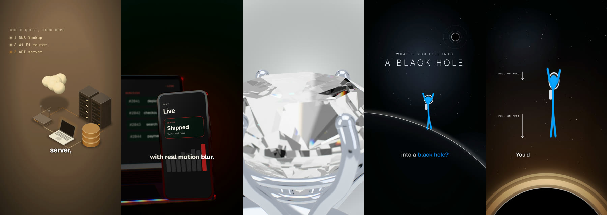

# cuekitvoltz

**Studio-grade motion, 3D, voice sync and QA for [Remotion](https://www.remotion.dev) videos, built to
be driven by [Claude Code](https://claude.com/claude-code).**

Remotion turns React into video. cuekitvoltz adds the craft layer on top:

- motion that feels physical
- cuts like an editor's
- an isometric world and a character host
- real 3D on your GPU
- a local voice-over that acts out emotion, and that the whole video syncs to
- a QA pass that catches what you'd otherwise only notice after uploading

<p align="center"></p>

<p align="center"></p>

## What's inside

| | |
|---|---|
| **Motion** | Closed-form springs (`duration` + `bounce`), easing, anticipation, follow-through, stagger, squash and stretch. Velocity-driven motion blur on anything that moves, and sub-frame blur for rotation and whole scenes. Per-glyph kinetic type. |
| **Transitions** | A frame-driven scene timeline with zoom-through, whip, push, wipe, iris, shape, liquid blob, match cut, light leak, Magic Move (shared elements) and shape morphing. Motion blur works through the cuts. |
| **Visual world** | An isometric kit (servers, databases, clouds, laptops, phones, routers, GPUs, people) with packets on routes. A 2D character rig with poses, gestures, blinking and lip-sync. A stick-figure astronaut and space scenery. Film, print and duotone looks. |
| **3D** | `<Scene3D>`: one WebGL canvas with sub-frame motion blur, bloom, depth of field and filmic tone mapping. Procedural light studios (no HDR files), PBR materials, camera rigs as pure functions, Lucide icons and type extruded in 3D, laptop and phone mockups with live React on the screen, and a ray-traced diamond with real dispersion. |
| **Voice** | A local voice director (Kokoro and Chatterbox-Turbo, both open source). Write a script with `[emotion]`, `(pause)`, `*emphasis*` and `@anchors`; it performs it, aligns every word, and writes `vo.json`. The video cuts on its sections, lands beats on its anchors, shows word-by-word captions, lip-syncs the character and ducks the music. Synthetic voices only. |
| **Themes and setup** | `npx cuekitvoltz init` asks a few questions: a suggested palette or your own colours (fonts, 3D light, iso colours and captions are derived from it, each theme in its own folder), which downloads you want with their real sizes, a default voice, and a starter video. |
| **QA** | Layout QA on rendered frames (safe areas, overlaps, small or clipped text, drawn right on the still), contact sheets, and renders normalised to -14 LUFS. |
| **Claude Code skills** | `cuekitvoltz-setup`, `motion-director`, `voice-director` and `video-qa`: Claude sets up a new project with you on your first prompt, builds with the kit the way a motion designer would, and checks the result before calling it done. |

## Try the examples

```bash
git clone https://github.com/<owner>/cuekitvoltz && cd cuekitvoltz
npm install
npm run dev                                   # Remotion Studio with every example
npm run stills -- showcase-enter 90 300 --qa  # frames + layout QA -> renders/_stills/showcase-enter/
npm run render -- showcase-kit --gpu          # -> renders/showcase-kit/showcase-kit.mp4
```

The examples are in [`examples/`](examples/). See [docs/examples.md](docs/examples.md) for the list.

## Use it in your project

You need an existing Remotion project (`npx create-video@latest`) on Remotion 4.0.535 or newer, with
React 19.

```bash
npm i cuekitvoltz @remotion/three @remotion/google-fonts @remotion/paths @remotion/shapes three @react-three/fiber
# before the first npm release: npm i github:<owner>/cuekitvoltz
npx cuekitvoltz init     # theme, downloads (asks first), default voice, starter video
```

See [docs/themes.md](docs/themes.md) for what setup asks and where it saves things.

```tsx
import { useVideoConfig } from 'remotion';
import { Move, Split, Stage, ease, spring, springs, stagger, tween } from 'cuekitvoltz';

export const Hello: React.FC = () => {
  const { fps } = useVideoConfig();
  return (
    <Stage background="#171717">
      {/* arrives already moving, overshoots a little, blurs while it's fast */}
      <Move x={spring({ at: 10, fps, from: 1200, to: 90, duration: 0.6, bounce: 0.25 })} y={() => 600}>
        <div style={{ width: 300, height: 180, borderRadius: 32, background: '#a31c1b' }} />
      </Move>
      <div style={{ position: 'absolute', left: 90, top: 340, fontSize: 96, color: '#f4d9a0' }}>
        <Split text="Hello, motion." unit={(i, n) => {
          const at = 20 + stagger(i, n, { each: 1.2 });
          return { y: spring({ at, fps, from: 60, to: 0, ...springs.snappy }), opacity: tween({ at, dur: 6, ease: ease.out }) };
        }} />
      </div>
    </Stage>
  );
};
```

Next: [Getting started](docs/getting-started.md).

## Claude Code skills

Install them as a plugin:

```
/plugin marketplace add <owner>/cuekitvoltz
/plugin install cuekitvoltz@cuekitvoltz
```

Or copy them into your project with `npx cuekitvoltz skills`, which writes to `.claude/skills/`.

Then ask Claude for a video in plain words, for example: "make a 30 s vertical explainer of what
happens when you press Enter, with a host who talks". See [docs/skills.md](docs/skills.md).

## Voice director

It runs in Python 3.11, locally. A GPU helps but isn't required.

```bash
npx cuekitvoltz download voice chatterbox      # or let init ask; shows sizes, asks first
npx cuekitvoltz direct src/intro/script.vo.md  # -> public/voice/intro.wav + src/intro/vo.json
npx cuekitvoltz hear src/intro/vo.json         # transcribes it back, flags garbled lines
```

```
# hook
[surprised] You press @enter *Enter*. (pause 0.25) What actually happens?
```

See [docs/voice.md](docs/voice.md).

## Command line

| Command | What it does |
|---|---|
| `npx cuekitvoltz init` | first-run setup: theme, downloads, default voice, starter video |
| `npx cuekitvoltz doctor` | what's installed and what's missing |
| `npx cuekitvoltz theme presets\|add\|list\|use\|build` | colour themes, each in `cuekitvoltz/themes/<name>/` |
| `npx cuekitvoltz download <items>` | `browser`, `gpu-browser`, `voice`, `chatterbox` or `all`, after showing the sizes |
| `npx cuekitvoltz voice-samples` / `config voice <preset>` | hear the voices / set the default |
| `npx cuekitvoltz starter` | writes a starter video on your theme and registers it |
| `npx cuekitvoltz stills <id> <frames...>` | renders frames from one bundle. `--qa` adds layout QA, `--sheet` a contact sheet, `--gpu` uses the GPU |
| `npx cuekitvoltz render <id...>` | renders an H.264 MP4, loudness-normalised (needs ffmpeg). `--gpu`, `--scale 2` for 2× size, `--cover <frame>` |
| `npx cuekitvoltz direct <script.vo.md>` | performs a voice script |
| `npx cuekitvoltz hear <vo.json>` | hear-back check of a voice track |
| `npx cuekitvoltz skills` | copies the Claude Code skills into `.claude/skills/` |

## Docs

- [Getting started](docs/getting-started.md)
- [Themes and setup](docs/themes.md)
- [Module reference](docs/README.md)
- [Motion](docs/motion.md)
- [Transitions](docs/transitions.md)
- [Visual world](docs/world.md)
- [3D](docs/3d.md)
- [Voice](docs/voice.md)
- [QA](docs/qa.md)
- [Rendering and GPU](docs/rendering.md)
- [Claude Code skills](docs/skills.md)
- [Examples](docs/examples.md)

## Requirements

- Node 20.11 or newer, and Remotion 4.0.535 or newer with React 19.
- three 0.170 and @react-three/fiber 9 for 3D.
- ffmpeg on the PATH, for loudness normalisation and contact sheets.
- For the voice director: Python 3.11 or uv. Kokoro and the aligner take ~0.7 GB, Chatterbox-Turbo
  ~4.6 GB, plus the Python libraries (~1.5 GB, or ~5 GB with CUDA). Setup shows the sizes and asks
  before downloading.
- A GPU is optional. Software WebGL works everywhere; on Linux, heavy 3D renders far faster with
  `--gpu`. See [docs/rendering.md](docs/rendering.md).

## Status

Version 0.1: everything here is used in the example videos, but the API can still change before 1.0.
The [changelog](CHANGELOG.md) lists what's in each release.

## License

- **Code:** cuekitvoltz is [MIT](LICENSE).
- **Remotion:** Remotion itself has its own license. It's free for individuals and companies of up
  to 3 people; larger companies need a [company license](https://www.remotion.dev/license).
- **Bundled assets and models:** fonts, icons, three.js and the TTS models have their own licenses.
  See [THIRD_PARTY_NOTICES.md](THIRD_PARTY_NOTICES.md).

Contributions are welcome: see [CONTRIBUTING.md](CONTRIBUTING.md).
