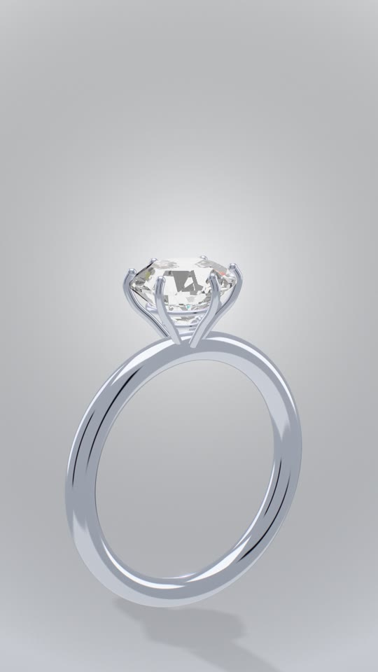

# 3D

```tsx
const cam = handheld(orbit({ target: [0, 1, 0], az: (f) => -8 + f * 0.1, el: 10, dist: 9 }));
const mac = laptopRig({ rotation: [0, 12, 0], open: spring({ at: 14, fps, duration: 1.1, bounce: 0.22 }) });

<Scene3D camera={cam} studio="warm" blur={{ samples: 6 }} post={{ bloom: {}, dof: { aperture: 14 } }}>
  <Laptop3D rig={mac} finish="silver" />
  <Anim position={[2, 0.6, 1]} rotation={[0, spring({ at: 8, fps, from: -420, to: 0 }), 0]}>
    <Icon3D icon={Zap} draw={tween({ at: 10, dur: 30 })} material={materials.neon('#A31C1B', 5)} />
  </Anim>
</Scene3D>
<ScreenOverlay camera={cam} quad={mac.screen} width={1280} height={800} dof={{ aperture: 14 }}>
  <Dashboard />   {/* any React */}
</ScreenOverlay>
```

## The pipeline

`<Scene3D>` is one WebGL canvas (through `@remotion/three`) with its own render pipeline:

1. **Motion blur.** Objects don't read the frame while React renders. They register `apply(t)` with
   `useMotion3D`, or use `<Anim>` with Motion props. The scene renders at `samples` moments across the
   shutter, re-applying every object and the camera rig each time, and averages them in HDR. Rotation,
   arcs, camera moves and drawn-on strokes all blur correctly.
2. **Bloom** on pixels whose brightest channel passes `threshold` (linear HDR, default 1.4), so a
   saturated red neon glows as readily as white. Mirror-highlight spikes are clamped first, so they
   don't bloom into square halos.
3. **Depth of field:** a golden-angle gather from a depth pass. Focus follows the camera rig's
   `focus` (by default its distance to the target), so pushing in keeps the subject sharp. Pass
   `focus` as a Motion to rack focus. `aperture` (animatable) is the blur in px at 1080p for something
   infinitely far.
4. **Finish:** chromatic aberration, vignette, neutral tone mapping (Khronos PBR Neutral, which keeps
   brand colours true), sRGB and dither.

An object animated through plain React props renders fine but doesn't blur. Animate through `Anim`
or `useMotion3D`.

## Light and materials

- **Studios:** `product`, `warm`, `ember`, `spectrum`, `sunset`, `noir` and `clay` are emissive
  softboxes baked into an environment map; no HDR files to download. Each adds a shadow-casting key
  light and an invisible floor that only catches soft shadows. You can pass your own `StudioSpec`
  (`panels`, `key`, `rim`, `bg`), and animate the light with `studioLevel` and `studioSpin` (a light
  sweep across metal).
- **Every mesh** casts and receives shadows unless `userData.shadow` / `userData.receive` is false.
- **`materials.*`** are PBR presets: `clay`, `plastic`, `glossy`, `rubber`, `ceramic`, `metal`,
  `anodized`, `chrome`, `gold`, `iridescent`, `glass` (real refraction), `frosted` and
  `neon(color, power)`.
- **Backgrounds:** a colour, a gradient with a glow (`{ top, bottom, glow, glowAt, glowSize }`), or
  `'transparent'` to sit on top of a 2D scene.

## Camera

- **Rigs** are pure functions of the frame:
  - `orbit({ target, az, el, dist, fov, roll, focus })`
  - `lookAt({ position, target, fov })`
  - `dollyZoom` (the vertigo shot)
  - `handheld(rig, { amount, speed, seed })` (seeded drift and roll)
  - `mixRigs(a, b, t)` to move between setups on a spring or tween
- The **same rig** places the DOM overlays (`ScreenOverlay`, `Pin3D`, `projectPoint`), so they never
  drift from the 3D.

## Objects

- **`Icon3D`:** a Lucide icon rebuilt as tubes with round joins and caps, drawn on by `draw` with a
  pen tip. Install `lucide` and pass its icon node.
- **`Text3D`:** extruded, bevelled glyphs from any `.ttf` URL (for example
  `staticFile('fonts/Geist-ExtraBold.ttf')`), parsed once with the opentype.js that ships with three.
  It takes mixed runs (fonts and materials), and `glyph(i, n)` moves each letter like 2D `Split`.
- **`Extrude3D`:** any filled SVG path as a solid.
- **Devices:** `laptopRig` and `phoneRig` describe placement, lid and screen corners as functions of
  the frame; `Laptop3D` and `Phone3D` draw generic devices with no brand marks.
  - `ScreenOverlay` warps live React onto the glass with a homography. It hides when the screen
    faces away, blurs with the scene's depth of field, and cuts holes where something passes in
    front (`occluders={[phone.outline]}`).
  - `Pin3D` pins a label to a 3D point.

## Gems

```tsx
<Scene3D camera={cam} studio="product" background={{ top: '#F7F8FA', bottom: '#D8DBE1' }}>
  <Gem size={0.82} lights={lightTent} dome={1.05} level={light} spin={sweep} fire={1.15} />
</Scene3D>
```



`<Gem>` is a convex cut stone, ray-traced per pixel in a fragment shader: Fresnel at entry,
refraction, up to `bounces` internal reflections with total internal reflection, and a separate exit
index of refraction per colour channel, which is what throws the rainbow "fire".

- **Cut:** `roundBrilliant(size, { crown, pavilion, table, girdle })` gives the facet planes of a
  round brilliant (57 facets plus the girdle); `convexSolid(planes)` builds any convex cut from planes.
- **Light:** the stone lights itself from its own cube map of softboxes, re-rendered every motion
  blur sample, so `level` and `spin` animate. Use `jewelleryStudio` for dark scenes and `lightTent`
  (bright dome, black flags) with `dome` around 1 for white high-key studios.
- **The dark arrows** a real diamond shows in a bright studio come from the camera's own reflection:
  `lens` sets how dark it is and `lensSize` how big.
- **`fire`:** 0 = no dispersion, 1 = a real diamond, more = more colour. `ior` overrides the
  per-channel index for other stones, and `tint` colours it.

The `kit-gem` board shows the stone alone, and `ring-ad` is a 30 s commercial built around it.

## Gotcha: first-frame state

`@remotion/three` renders the frame from a passive effect of a sibling component. So anything that
must be in place before the frame renders (uniforms, `onBeforeRender` hooks) belongs in
`useLayoutEffect`, not `useEffect`. Otherwise the first frame, which means every still, renders
without it.

## Rendering

Remotion's default headless browser has no GPU path on Linux, so WebGL runs in software there. Heavy
3D renders far faster on the GPU, but needs concurrency 1. See [rendering.md](rendering.md).

The `kit-3d-materials` and `kit-3d-type` boards show the studios, materials and type;
`kit-reel-3d` and `showcase-product` are product shots.
